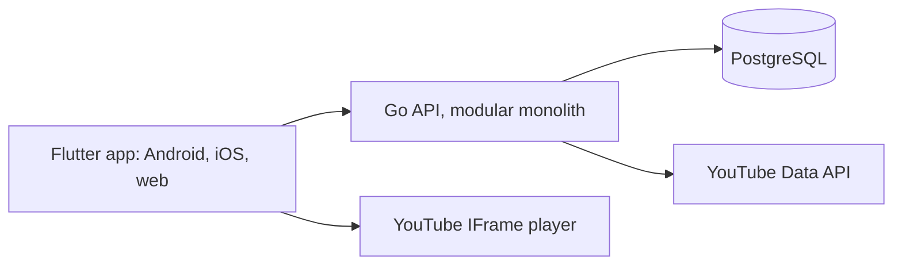

  <picture>
    <source media="(prefers-color-scheme: dark)" srcset="brand/svg/telinha-segura-lockup-color-on-dark.svg">
    
  </picture>

  

    
    
  

## Em poucas palavras

A Telinha Segura é um app de vídeos para crianças em que só passa o que pais, cuidadores e pessoas que trabalham com crianças assistiram antes e seguem revisando. É gratuito, sem anúncios e sem rastreio no modo criança. Quem controla é o responsável, e só ele sai do modo criança. O app está em desenvolvimento, começando pelo Brasil.

## Telinha Segura

A children's video app where children watch only YouTube videos that a community of parents, caregivers and people who work with children has screened, and keeps re-reviewing. It is a cross-platform app (Android, iOS and web) with parental controls, and other content sources are to follow.

Unlike apps curated by an algorithm or a faceless editorial team, here parents, caregivers and people who work with children screen what plays and keep reviewing it.

## Status

Pre-release. Brazil and pt-BR first. The app is not yet in the stores.

## Principles

1. People, not a machine: every promise traces to a human judgement.
2. Enough, not more: a bounded set, never a feed, streak or time counter.
3. Calm over fear: the product reassures by being plain, never by alarm.
4. The child's boundary is real: enforced by the server, not the UI.
5. Brazilian at heart: it sounds like a neighbour, not a translation.

On top of these: no tracking, analytics or third-party SDKs in kid mode.

Business model: free on both stores, no ads, no in-app purchases. Voluntary donations happen only outside the app (on the site and GitHub), and the app never links to or prompts them.

## Architecture

A Flutter app (`app/`) and a Go backend (`backend/`) live in one monorepo. The backend is a modular monolith: one HTTP binary (`backend/cmd/api`) whose domains are packages under `backend/internal/`, each owning its SQL, over PostgreSQL as the system of record. The child's boundary is enforced by the server, not the app.

## Quick start

Preparing a machine and running the app on an emulator are covered in [docs/development/](docs/development/).

- `make doctor` — checks the machine
- `make api` — runs the API locally
- `make run-android` / `make run-ios` — runs the app on the emulator or simulator
- `make check` — full gate: `gofmt -l`, `go vet`, `go test`, `go build` in every Go module; `dart format --set-exit-if-changed`, `flutter analyze`, `flutter test` in every Dart/Flutter package
- `make fast` — format and static analysis, no tests
- `make go-test` / `make dart-test` — the tests of one toolchain
- `gofmt -w <file>` / `dart format <file>` — fix the formatting of a file

`make check` is the full gate, and the same command CI runs.

## Where things are

- `app/` — the Flutter app (Android, iOS and web)
- `backend/` — the Go API and its admin command
- `docs/development/` — from a fresh clone to the app running locally
- `brand/` — brand assets: logo SVGs, favicon and app icons, e-mail PNGs, brand tokens
- `deploy/` — the backup image
- `site/` — the public site
- `scripts/` — the scripts behind the `make` targets and CI
- `tools/` — `repoconfig`: tests pinning the repository's configuration; `dco`: the sign-off check; `sitecheck`: tests pinning the public site

## Contributing

Contributions are welcome. Read [CONTRIBUTING.md](CONTRIBUTING.md) first: every commit needs a DCO sign-off. Please follow the [Code of Conduct](CODE_OF_CONDUCT.md). Report vulnerabilities as described in [SECURITY.md](SECURITY.md), and find help in [SUPPORT.md](SUPPORT.md).

## Apoie o projeto

A Telinha Segura é gratuita e sem anúncios, e nada no app pede dinheiro. Se quiser ajudar a mantê-la, há uma contribuição voluntária por Pix em [telinhasegura.coding4u.tech/apoie](https://telinhasegura.coding4u.tech/apoie). It is voluntary, buys nothing and goes to Coding For You Tecnologia Ltda, which is not a nonprofit.

## License

AGPL-3.0-only, with a permission that allows distributing the app through app stores. In SPDX terms:

`AGPL-3.0-only WITH LicenseRef-telinha-app-store-exception`

See [COPYRIGHT.md](COPYRIGHT.md), [LICENSE](LICENSE), [LICENSE-EXCEPTION.md](LICENSE-EXCEPTION.md) and [TRADEMARKS.md](TRADEMARKS.md).

© 2026 Coding For You Tecnologia Ltda.
